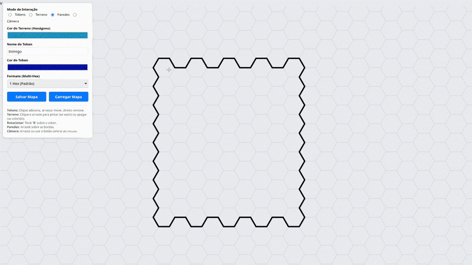
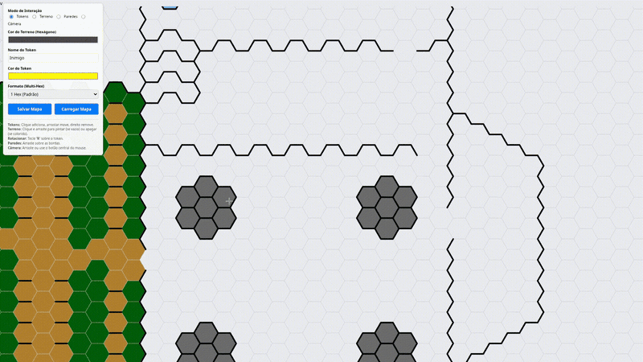
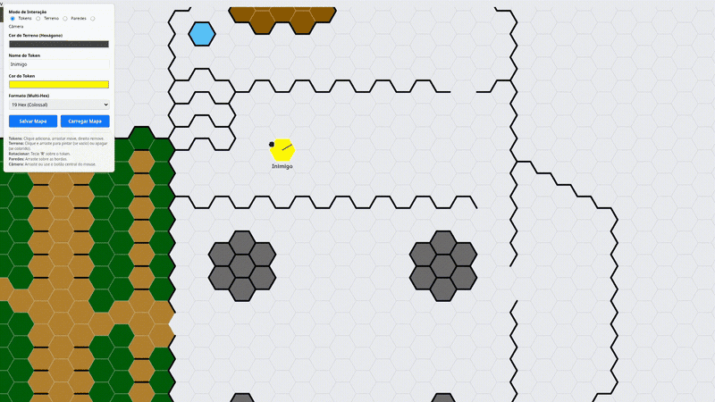

# GURPS Grid Generator

**English** | [Português (BR)](README.pt-BR.md)

An offline hex-grid tactical map editor for GURPS and other tabletop RPGs.
Create and save maps, paint terrain, draw walls and manage multi-hex tokens —
all in a single page that runs directly in the browser, with zero dependencies.

## Features

- **Terrain painting**: click and drag to paint or erase hex colors (right-click erases).
- **Walls**: drag along hex edges to add or remove them.
- **Tokens**: 9 shapes from 1 hex up to 19-hex colossal, with name, color and facing.
- **Multi-hex validation**: tokens cannot overlap each other when placed, moved or rotated.
- **Selection & editing**: click a token to select it, edit its name/color/shape in the panel.
- **Keyboard**: `R` rotates, arrow keys move, `Delete` removes, `Ctrl+Z`/`Ctrl+Shift+Z` undo/redo.
- **Zoom & pan**: mouse wheel to zoom, middle-button drag or Camera mode to pan.
- **Coordinates**: optional `q,r` labels on every hex.
- **Save/Load**: versioned, validated JSON files (see below).
- **Autosave**: the session is kept in `localStorage` and restored on the next visit.
- **Languages**: switch between Portuguese (Brazil) and English in the panel.
- **Touch support**: works with pointer events on tablets and touch screens.

## Usage

No build step and no server are required:

1. Download or clone this repository.
2. Open `index.html` in any modern browser.

Everything runs locally; no data leaves your machine.

## Controls

| Action                 | Input                                           |
| ---------------------- | ----------------------------------------------- |
| Add token              | Click an empty hex (Tokens mode)                |
| Move token             | Drag it (Tokens mode)                           |
| Remove token           | Right-click it, or select it and press `Delete` |
| Rotate token           | Press `R` over/with the selected token          |
| Move selected token    | Arrow keys                                      |
| Paint / erase terrain  | Click and drag (right-click erases)             |
| Draw walls             | Drag along edges (Walls mode)                   |
| Pan camera             | Middle-button drag, or drag in Camera mode      |
| Zoom                   | Mouse wheel                                     |
| Undo / redo            | `Ctrl+Z` / `Ctrl+Shift+Z` (or `Ctrl+Y`)         |
| Deselect / center view | `Esc` / Center button                           |

## Save format

Maps are plain JSON files. The format is versioned and validated on load;
malformed entries are dropped instead of breaking the app.

```json
{
    "version": 1,
    "mapName": "example_map",
    "camera": { "x": 60, "y": 40 },
    "entities": {
        "0,0": {
            "name": "Hero",
            "color": "#3399ff",
            "shape": [{ "q": 0, "r": 0 }],
            "facing": 0
        }
    },
    "walls": ["0,0|1,-1"],
    "hexColors": { "1,0": "#a3d9a5" }
}
```

An example file is available at [`examples/example_map.json`](examples/example_map.json).

## Development

Requirements: Node.js 20+.

```sh
npm install       # install dev tooling (ESLint, Prettier, Vitest)
npm run lint      # static analysis
npm run format    # apply code formatting
npm test          # unit tests
npm run check     # lint + format check + tests
```

The application itself has no runtime dependencies — the tooling is only used
for development and CI.

## Map creation



## Wide variety of tokens



## Simple creation and movement



## License

[MIT](LICENSE)
